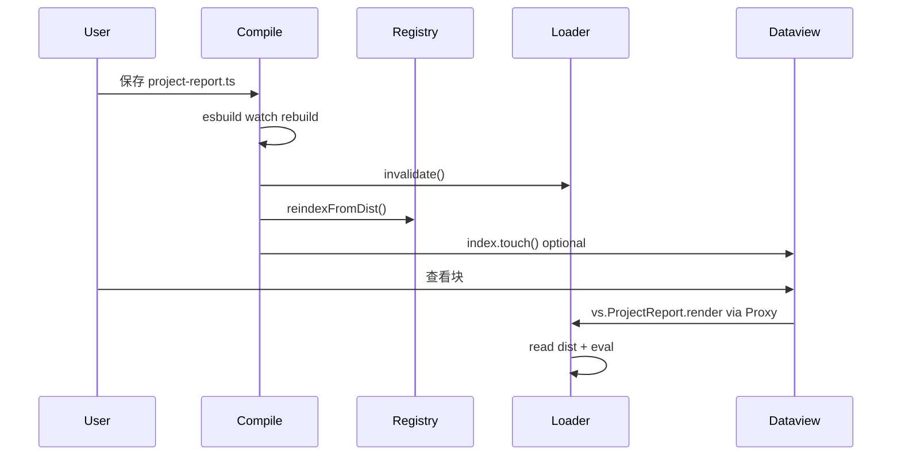
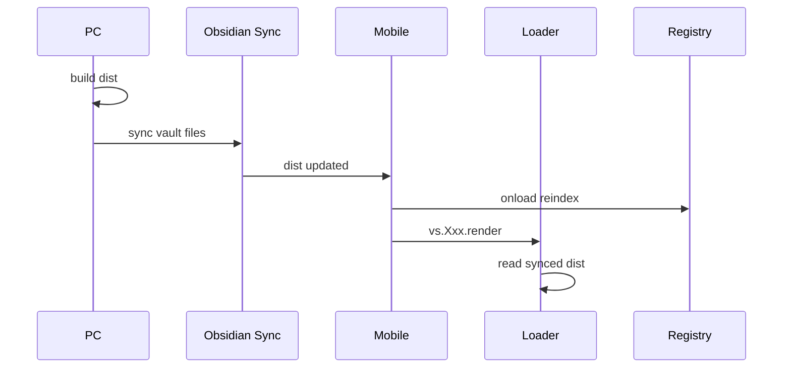
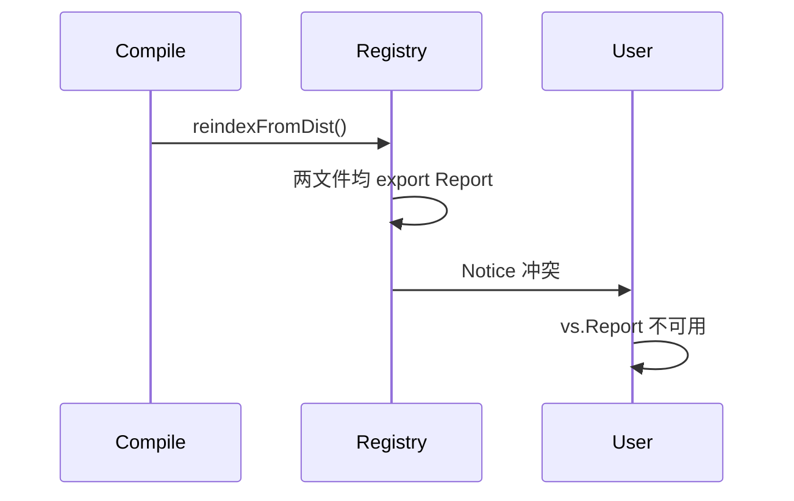

# Vault Scripts 插件 — L0 技术整体设计

> 架构师设计文档 · 需求来源：[prd.md](./prd.md) · L1 细化：[L1.md](./L1.md) · 执行计划：[delivery-plan.md](./delivery-plan.md)

---

## Design Doc Title & TL;DR

**Vault Scripts**：Obsidian 社区插件，**Compile（仅 PC 运行时）+ Runtime（PC/Mobile 双端）**；用户在 `{scriptsRoot}/src` 写 TS/ESM，**PC** esbuild 预编译为 `{plugin}/dist/` CJS bundle，**PC 与 Mobile** 均通过 **`vs.<导出名>`** Lazy Proxy 加载 dist。

**TL;DR**

- 单一 `main.js`；**PC 与 Mobile 均安装、均可调用 `vs`**。
- 唯一用户配置：`scriptsRoot` → 推导 `srcDir`。
- 唯一用户 API：`vs.<ExportName>`（class static / function）；无路径加载。
- **Compile 仅 PC**（`Platform.isDesktopApp`）；Mobile 不编译，读 Sync 后的 dist。
- ExportRegistry 维护 **导出名 → dist 路径**；ModuleLoader fs + eval CJS。

---

## Assumptions & Scope

**Assumptions**

- PRD AC-1～AC-9 为验收基准。
- **PC 与 Mobile 使用同一 `main.js`**；Compile 模块仅在 PC onload 时初始化。
- PC 具备 Node `fs` 与 esbuild native binary；Mobile 无编译能力但可运行 Runtime。
- dist 在 vault 内 `.obsidian/plugins/vault-scripts/dist/`，Obsidian Sync 同步。

**In Scope（L0）**：BuildService、ModuleLoader、ExportRegistry、LazyExportProxy、CommandRegistry、Settings、onload 生命周期。

**Out of Scope**：npm bundle、路径 API、运行时 TS 检查、QuickAdd 表单。

---

## Architecture Principles

1. **Compile / Runtime 分离**：Compile **仅 PC 运行时**启用；Runtime **PC/Mobile 双端**；契约 = dist 文件 + ExportRegistry 索引。
2. **契约优先**：Runtime 不读 src；只读 dist + 导出名表。
3. **扁平导出名**：用户 API 一层 `vs.Xxx`；文件夹仅影响 dist 镜像路径（内部）。
4. **可观测性**：编译失败 Notice；sourcemap；Rebuild 命令。
5. **失败可控**：编译失败保留旧 dist；load retry 一次。

---

## System Overview（L0 模块总览）

| L0 模块              | 能力                                        | 边界（不做）     | 数据所有权             | 对外契约                 |
| -------------------- | ------------------------------------------- | ---------------- | ---------------------- | ------------------------ |
| **Settings**         | 读写 `data.json`、设置页                    | 不解析 export    | `VaultScriptsSettings` | 插件设置 UI              |
| **Paths**            | 解析 `scriptsRoot`→`srcDir`/`distDir`       | 不 build         | 无持久化               | 内部 API                 |
| **Compile**          | entry 发现、esbuild build/watch、prune dist | 不 eval、不挂 vs | 写 `dist/`             | onEnd 回调               |
| **Runtime.Loader**   | fs 读 dist、CJS eval、cache、require shim   | 不编译           | cache 内存             | `loadModule(distPath)`   |
| **Runtime.Registry** | 扫 dist 建导出名表、冲突检测                | 不执行用户业务   | `ExportEntry[]` 内存   | `loadByExportName`       |
| **Runtime.Proxy**    | `window.vs` Lazy Proxy                      | 不路径寻址       | 无                     | `vs.Xxx.method()`        |
| **Runtime.Commands** | 注册 `static invoke` 命令                   | 无表单           | 命令 id 列表           | Obsidian commands        |
| **PluginHost**       | onload/onunload 编排                        | 不含业务         | 无                     | Obsidian Plugin 生命周期 |

### 系统级 L0 协作流程（主路径）

1. **PluginHost.onload** → Settings.load → Paths.resolve。
2. **PC**：Compile.startWatch → onEnd → Registry.reindex → Commands.reregister → Loader.invalidate → optional dataview touch。
3. 用户 **dataviewjs（PC/Mobile）** 访问 `vs.ProjectReport.render` → Proxy → Registry → Loader → eval dist → 调用 static method。
4. **Mobile**：跳过 Compile 初始化；Registry/Loader 与 PC 相同，读 Sync 后的 dist。

---

## Module Specs（逐模块细化）

### Settings

- **Owned Data**：`VaultScriptsSettings`（`data.json`）
- **字段**：`scriptsRoot: string`；`autoWatch: boolean`；`showBuildNotice: boolean`
- **Commands**：保存 settings → 触发 Rebuild + reindex
- **失败**：空 `scriptsRoot` → 不启动 Compile

### Paths

```typescript
interface ResolvedPaths {
  scriptsRoot: string | null; // absolute, in vault
  srcDir: string | null; // join(scriptsRoot, "src")
  distDir: string; // join(manifest.dir, "dist")
}
```

- 校验：`scriptsRoot` 相对 vault 根，禁止 `..` 逃逸。

### Compile（BuildService + EntryDiscovery）

**Entry 发现**（当且仅当）：

- `.ts` / `.mts` / `.mjs`
- 在 `srcDir` 下
- 路径不含 `_` 前缀目录段；文件名不以 `_` 开头
- 非 `*.d.ts`、`*.test.ts`、`*.test.mjs`

**esbuild 参数**：

```typescript
await esbuild.build({
  entryPoints,
  outdir: distDir,
  outbase: srcDir,
  bundle: true,
  format: 'cjs',
  platform: 'neutral',
  target: 'es2020',
  sourcemap: true,
  external: OBSIDIAN_EXTERNALS, // obsidian + codemirror 包
});
```

**watch**：`esbuild.context().watch()`；`onEnd` → 通知 PluginHost。

**pruneOrphanDist**：对比 entry 集合，删除多余 `.js`/`.map`。

### Runtime.Loader（ModuleLoader）

**流程**：

```
loadModule(absoluteDistPath)
  → stat mtime → cache hit? return exports
  → readFile → evalCjs(code, { require: pluginRequire, module, exports })
  → cache.set → return exports
```

**require shim**：`obsidian`、CodeMirror 包 → `pluginRequire`；其余报错。

**Cache**：`Map<distPath, { mtime, exports }>`；`invalidate(all?)` on rebuild。

### Runtime.Registry（ExportRegistry）

**reindexFromDist**（MVP）：

1. 递归列出 `dist/**/*.js`（排除 `.map`）。
2. 对每个文件 eval（或 loadModule）读 `module.exports`。
3. 对每个 **named export** 写入 `exportName → distPath`。
4. 若 `exportName` 已存在 → 标记冲突，两者均不注册。
5. 若 export 为 class 且 `typeof Xxx.invoke === 'function'` → `hasInvoke: true`。

### Runtime.Proxy（LazyExportProxy）

- `vs` 为 Proxy：`get(target, exportName)` → 返回 **ExportProxy**。
- **Class static**：`get(_, prop)` → loadModule → `exports[exportName][prop]`，bind 后返回。
- **Function export**：`apply` 直接调用 `exports[exportName]`。
- 不存在或冲突的 exportName → throw 明确错误。

### Runtime.Commands（CommandRegistry）

- reindex 后：移除旧命令，对 `hasInvoke` 的 entry 注册 `Vault Scripts: {ExportName}`。
- handler：`() => vs.{ExportName}.invoke(app)`。
- 额外：`Vault Scripts: Rebuild & reload`。

### PluginHost（main.ts）

**onload 顺序**：

```
loadSettings → resolvePaths
→ if Desktop && paths.ok: compile.start(watch) → initial build
→ registry.reindexFromDist()
→ commands.registerAll()
→ window.vs = createVsProxy(registry, loader)
→ registerRebuildCommand
```

**onunload**：`compile.dispose()`；`commands.unregisterAll()`；`loader.invalidate()`。

---

## Data Model & Migrations

无服务端 DB。持久化仅：

| 存储     | 位置                                        | 内容      |
| -------- | ------------------------------------------- | --------- |
| 插件设置 | `.obsidian/plugins/vault-scripts/data.json` | Settings  |
| 编译产物 | `.obsidian/plugins/vault-scripts/dist/**`   | CJS + map |
| 源码     | `{vault}/{scriptsRoot}/src/**`              | 用户 TS   |

无 DB 迁移。插件只管理 `{scriptsRoot}/src` 与 `{plugin}/dist/`。**既有 vault 脚本如何迁入 `src/` 不在插件范围**。

---

## API Contract

### 用户 API（Runtime 对外）

| 接口                                      | 语义                          | 错误                                       |
| ----------------------------------------- | ----------------------------- | ------------------------------------------ |
| `vs.<ExportName>.<staticMethod>(...args)` | 加载 dist 并调用 class static | 未注册 / 冲突 / load 失败 → Error + Notice |
| `vs.<ExportName>(...args)`                | 函数 export                   | 同上                                       |
| `vs.<ExportName>.invoke(app)`             | 命令类脚本                    | 同上                                       |
| 命令面板                                  | `Vault Scripts: <ExportName>` | invoke 异常 → Notice                       |

**不提供**：`vs("path")`、`vsInvoke(id)`、HTTP API。

### 插件 API

```typescript
interface VaultScriptsPluginApi {
  vs: VsProxy;
  rebuild(): Promise<void>;
}
```

### 错误码（内部语义）

| 代码                  | 含义            | 用户反馈                   |
| --------------------- | --------------- | -------------------------- |
| `VS_NOT_CONFIGURED`   | scriptsRoot 空  | 打开设置                   |
| `VS_BUILD_FAILED`     | esbuild 错误    | Notice + log               |
| `VS_EXPORT_NOT_FOUND` | 无此导出名      | 抛错                       |
| `VS_EXPORT_CONFLICT`  | 导出名冲突      | Notice（reindex 时）       |
| `VS_DIST_MISSING`     | dist 文件不存在 | Notice；Desktop 触发 build |

### 幂等 / 分页

不适用（本地插件，无网络 API）。

---

## Technical Rationale & Sequence Diagrams

### 场景 1：Desktop 保存 src → dataview 刷新



### 场景 2：Mobile Sync 后首次调用



### 场景 3：导出名冲突



**可行性**：eval 索引简单可靠；冲突显式失败优于 silent overwrite。

---

## Security & Permissions

- 用户脚本 = **任意代码**，等同 CustomJS 威胁模型。
- Compile 只写 `distDir`；只读 `srcDir`。
- Runtime 不提供 `child_process` / 任意 shell（v1）。
- `scriptsRoot` 路径校验防 vault 逃逸。

---

## Observability

| 项         | 方式                     |
| ---------- | ------------------------ |
| 编译错误   | `console.error` + Notice |
| 运行时错误 | `console.error` + Notice |
| 调试       | sourcemap；DevTools      |
| 指标       | 无（个人 vault）         |

---

## Testing Strategy

| 层级            | 覆盖                                               |
| --------------- | -------------------------------------------------- |
| **Unit**        | EntryDiscovery 规则；Paths 校验；Registry 冲突检测 |
| **Integration** | 临时 vault：src → build → eval exports；Proxy 调用 |
| **Manual E2E**  | PRD AC-1～AC-9                                     |

### AC 映射

| AC   | 测试                |
| ---- | ------------------- |
| AC-1 | Integration build   |
| AC-2 | E2E dataview        |
| AC-3 | E2E 命令面板        |
| AC-4 | E2E Templater       |
| AC-5 | watch + 二次调用    |
| AC-6 | \_utils import only |
| AC-7 | 故意冲突 reindex    |
| AC-8 | 删 src prune        |
| AC-9 | Mobile 手工         |

（AC 定义见 prd.md；不含遗留脚本迁移验收。）

---

## Rollout Plan

1. **Dev**：BRAT / 本地加载插件。
2. **Dogfood**：用示例 entry 验证 AC。
3. **发布**：社区插件仓库。
4. **回滚**：禁用插件；dist 可删后 Desktop rebuild。

---

## Non-functional Requirements

| 项           | 目标                                                                        |
| ------------ | --------------------------------------------------------------------------- |
| PC compile   | 个人 vault 规模 rebuild <1s 量级                                            |
| Runtime load | cache 命中 O(1)；miss 读盘 + eval                                           |
| 插件 bundle  | 单一 `main.js`；Mobile 运行时不初始化 Compile（体积可含 esbuild，但不调用） |
| 可靠性       | 编译失败保留旧 dist                                                         |

---

## Risks & Mitigations

| 级别 | 风险                        | 缓解                             |
| ---- | --------------------------- | -------------------------------- |
| P1   | Mobile 无 dist              | Notice；文档假设 PC 先 build     |
| P1   | eval 索引 dist 性能         | 仅 reindex 时 eval；cache 运行时 |
| P2   | .obsidian modify 事件不可靠 | Desktop 以 esbuild onEnd 为准    |
| P2   | 插件升级丢 dist             | PC onload rebuild                |

---

## Open Technical Questions

| 级别 | 问题                                               | 推荐                                                            |
| ---- | -------------------------------------------------- | --------------------------------------------------------------- |
| P1   | ExportRegistry 用 eval 还是 AST 扫 exports         | MVP eval                                                        |
| P1   | Mobile 是否调用 Compile                            | 否（`Platform.isDesktopApp`）；与 main.js 是否打包 esbuild 无关 |
| P2   | reindex 是否并行 eval 多 dist                      | 可并行，注意 CPU                                                |
| P2   | Function export Proxy 与 class static 分支测试矩阵 | 单测覆盖                                                        |
| P3   | 自动生成 `vs.d.ts` 时机                            | P2                                                              |

---

## Implementation Milestones

### P0 — MVP（对齐 PRD P0）

- [ ] 插件脚手架（manifest、esbuild 打 main.js）
- [ ] Paths + Settings 页
- [ ] Compile：discover + build + watch + onEnd
- [ ] Loader + Registry + Proxy + Commands
- [ ] PluginHost 生命周期
- [ ] AC-1～AC-6 通过

### P1

- [ ] pruneOrphanDist
- [ ] 冲突 Notice
- [ ] AC-7～AC-9
- [ ] 可选 Mobile dist 监听

### P2

- [ ] vs.d.ts
- [ ] npm 依赖目录

---

## 插件仓库结构（实现参考）

```
vault-scripts/
  main.ts
  settings.ts
  compile/
    BuildService.ts
    EntryDiscovery.ts
  runtime/
    ModuleLoader.ts
    ExportRegistry.ts
    LazyExportProxy.ts
    CommandRegistry.ts
  paths.ts
  types.ts
  externals.ts
```

**插件发布物**：单一 `main.js`（Obsidian 唯一入口）。**PC 与 Mobile 均安装同一文件**；Compile 仅在 `Platform.isDesktopApp` 时于运行时初始化，Mobile 只消费 Sync 后的 `dist/`。

---

_L0 版本：1.0 · 来源：原 tech-design.md 技术部分 · 需求：prd.md_
