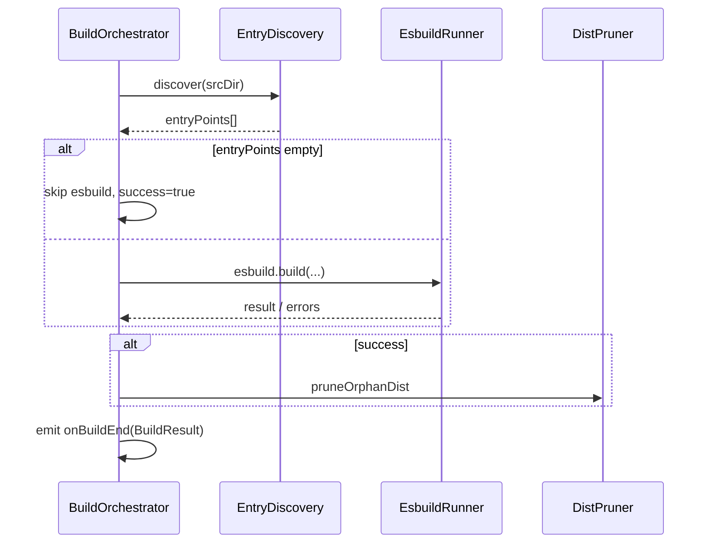
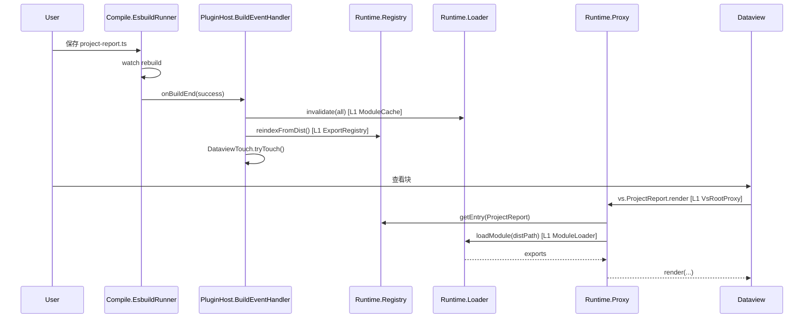
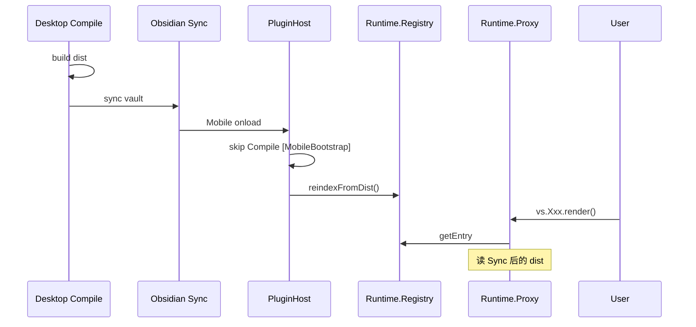
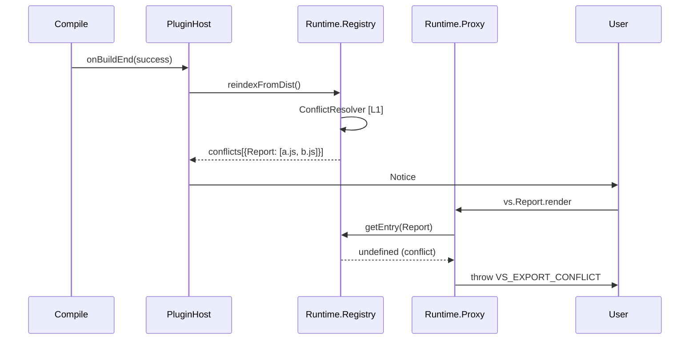
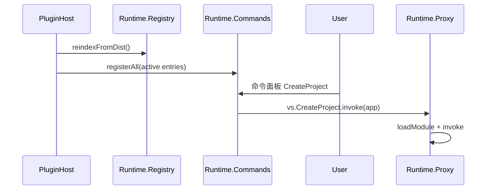

# Vault Scripts 插件 — L0→L1 细化设计

> 架构师 / Tech Lead 落地设计 · 来源：[L0.md](./L0.md) · 需求：[prd.md](./prd.md) · 执行计划：[delivery-plan.md](./delivery-plan.md)

---

## 1. Design Doc Title & TL;DR

**Vault Scripts L1 细化设计**：在 L0 八模块骨架上，拆出可独立实现与单测的 L1 子模块，明确数据结构、模块内/跨模块接口、失败语义与 AC 测试映射。

**TL;DR**

- **Compile（仅 PC 运行时）**：EntryDiscovery → EsbuildRunner → DistPruner；`onBuildEnd` 事件驱动 Runtime 刷新。
- **Runtime（PC/Mobile 双端）**：ModuleLoader（fs + eval + cache）← ExportRegistry（reindex）← LazyExportProxy（`window.vs`）→ CommandRegistry。
- **编排中心 PluginHost**：onload/onunload 时序固定；Settings/Paths 变更触发 rebuild + reindex（rebuild 仅 PC）。
- **契约**：用户仅见 `vs.<ExportName>`；内部 `ExportEntry { exportName, distPath, hasInvoke, status }`。
- **MVP 索引策略**：reindex 时对 dist 做 CJS eval 扫 named export（L0 已定）。

---

## 2. Source Architecture Reference（输入摘要与引用）

### 2.1 抽取的 L0 模块清单

| L0 模块              | 能力摘要                               | Owned Data             | 对外契约                  |
| -------------------- | -------------------------------------- | ---------------------- | ------------------------- |
| **Settings**         | 读写 `data.json`、设置页               | `VaultScriptsSettings` | Obsidian PluginSettingTab |
| **Paths**            | `scriptsRoot` → `srcDir` / `distDir`   | 无持久化               | `resolvePaths()`          |
| **Compile**          | entry 发现、esbuild build/watch、prune | 写 `dist/`             | `onBuildEnd` 回调         |
| **Runtime.Loader**   | fs 读 dist、CJS eval、cache            | 内存 cache             | `loadModule(distPath)`    |
| **Runtime.Registry** | 扫 dist 建导出名表、冲突检测           | `ExportEntry[]`        | `loadByExportName(name)`  |
| **Runtime.Proxy**    | `window.vs` Lazy Proxy                 | 无                     | `vs.Xxx.*`                |
| **Runtime.Commands** | 注册 `static invoke` 命令              | 命令 id 列表           | Obsidian commands API     |
| **PluginHost**       | onload/onunload 编排                   | 无                     | Obsidian Plugin 生命周期  |

### 2.2 跨模块契约索引（API & Event Catalog）

| 名称                                          | 类型     | Producer              | Consumer(s)                           | Owner      |
| --------------------------------------------- | -------- | --------------------- | ------------------------------------- | ---------- |
| `resolvePaths(vault, settings)`               | 内部 API | Paths                 | PluginHost, Compile                   | Paths      |
| `compile.start(watch?)` / `compile.rebuild()` | 内部 API | Compile               | PluginHost, Settings                  | Compile    |
| `onBuildEnd(result: BuildResult)`             | 内部事件 | Compile.EsbuildRunner | PluginHost → Registry/Loader/Commands | Compile    |
| `loader.loadModule(distPath)`                 | 内部 API | Runtime.Loader        | Registry, Proxy                       | Loader     |
| `registry.reindexFromDist()`                  | 内部 API | Runtime.Registry      | PluginHost, onBuildEnd                | Registry   |
| `registry.getEntry(exportName)`               | 内部 API | Runtime.Registry      | Proxy, Commands                       | Registry   |
| `createVsProxy(registry, loader)`             | 内部 API | Runtime.Proxy         | PluginHost                            | Proxy      |
| `commands.registerAll(entries)`               | 内部 API | Runtime.Commands      | PluginHost, onBuildEnd                | Commands   |
| `vs.<ExportName>`                             | 用户 API | Runtime.Proxy         | dataview/Templater/用户               | Proxy      |
| `plugin.rebuild()`                            | 插件 API | PluginHost            | 命令面板 / 外部                       | PluginHost |
| `settings.save()`                             | 内部 API | Settings              | PluginHost                            | Settings   |

### 2.3 关键场景（来自 L0）

1. **PC** 保存 src → watch rebuild → **PC/Mobile** dataview 调用 `vs.Xxx`
2. **Mobile** Sync dist → onload reindex → 调用 `vs.Xxx`（不编译）
3. 导出名冲突 → reindex Notice → `vs.Xxx` 不可用

### 2.4 Input Gaps（L0 缺失项）

| 级别 | 缺口                                                  | 处理                                                     |
| ---- | ----------------------------------------------------- | -------------------------------------------------------- |
| P2   | 无独立「Event Catalog」章节                           | 本节 2.2 补齐；L1 用 `onBuildEnd` 作为唯一跨模块异步事件 |
| P2   | ExportRegistry eval 算法未字段级定义                  | L1 Registry 子模块 pseudo-schema + 步骤                  |
| P2   | Proxy 对 function export vs class static 分支未形式化 | L1 Proxy 子模块接口表                                    |
| P3   | Mobile dist 变更监听未定时序                          | L1 Open Questions 保留 P1                                |

### 2.5 Assumptions

- PRD AC-1～AC-9 为验收基准；不含遗留脚本迁移。
- **单一 `main.js`**；PC 与 Mobile 均安装、均可调用 `vs`。
- **Compile 仅 PC**：`Platform.isDesktopApp` 时初始化；Mobile 运行时不调用 Compile。
- dist 固定于 `.obsidian/plugins/vault-scripts/dist/`；Obsidian Sync 同步。
- 用户脚本威胁模型同 CustomJS；不提供 shell / child_process。

---

## 3. Global Conventions（全局约定）

### 3.1 ID / 时间 / 版本

| 项                      | 约定                                                                      |
| ----------------------- | ------------------------------------------------------------------------- |
| **命令 id**             | `vault-scripts:invoke:{exportName}`（小写 exportName）                    |
| **Rebuild 命令 id**     | `vault-scripts:rebuild`                                                   |
| **dist 路径**           | vault 绝对路径；Registry/Loader 统一用 absolute                           |
| **mtime**               | `fs.statSync(path).mtimeMs` 作为 cache 失效依据                           |
| **插件版本**            | `manifest.json version`；升级时 onload 触发 rebuild（Desktop）            |
| **BuildResult.buildId** | 每次 successful/failed build 递增 monotonic counter（内存），用于日志关联 |

### 3.2 错误语义

**分层**

| 层       | 代码前缀               | 处理                                              |
| -------- | ---------------------- | ------------------------------------------------- |
| 配置     | `VS_NOT_CONFIGURED`    | Notice + 打开设置页链接                           |
| 编译     | `VS_BUILD_FAILED`      | Notice（可选 `showBuildNotice`）+ `console.error` |
| 索引     | `VS_EXPORT_CONFLICT`   | reindex 时 Notice；冲突名 status=`conflict`       |
| 运行时   | `VS_EXPORT_NOT_FOUND`  | Proxy get/apply 抛 `Error`                        |
| 运行时   | `VS_DIST_MISSING`      | Notice；Desktop 尝试 `rebuild()`                  |
| 用户脚本 | `VS_USER_SCRIPT_ERROR` | invoke/load 异常 → Notice + rethrow               |

**重试**：`loadModule` 首次失败 retry 1 次（L0）；rebuild 无自动重试。

**幂等**：`rebuild()`、`reindexFromDist()` 可重复调用；结果以最后一次为准。编译失败**不**删除已有 dist（PRD guardrail）。

### 3.3 权限与审计

- 无多用户鉴权；用户脚本在其 vault 内以 Obsidian app 权限运行。
- 审计：仅 `console.error` / DevTools；无持久化审计日志（P3 可扩展）。

### 3.4 可观测性

| 字段            | 传播                                                                 |
| --------------- | -------------------------------------------------------------------- |
| `buildId`       | Compile onBuildEnd → PluginHost 日志                                 |
| `exportName`    | Proxy/Registry/Commands 错误日志                                     |
| `distPath`      | Loader 错误日志                                                      |
| `correlationId` | 单次 `rebuild()` 或 watch onEnd 生成 UUID，贯穿 reindex + reregister |

**日志前缀**：`[vault-scripts]`。

### 3.5 接口风格

- 全本地、同步/异步混合；无 HTTP。
- **onBuildEnd**：至多一次语义（esbuild watch 每次 rebuild 结束触发一次）；消费者须幂等。
- **dedupeKey**：`correlationId` + `buildId`；PluginHost 忽略乱序的旧 build（`buildId < lastAppliedBuildId`）。

### 3.6 路径与安全

- `scriptsRoot`：相对 vault 根，禁止 `..`、绝对路径、vault 外解析。
- Compile 只写 `distDir`；只读 `srcDir`。
- `pluginRequire` 白名单：`obsidian` + CodeMirror 相关包（见 `externals.ts`）。

---

## 4. L0 Module Refinements（逐个 L0 模块的 L1 细化）

---

### L0 Module: Settings

#### 4.1 L0 回顾

- **定位**：插件唯一持久化配置入口。
- **能力/边界**：读写 `data.json`、渲染设置页；不解析 export、不 compile。
- **Owned Data**：`VaultScriptsSettings`。
- **Public Contracts**：Obsidian `PluginSettingTab`。

#### 4.2 L1 Submodules

| L1 子模块                  | 职责                   | 边界（不做） | 输入/输出                           | Owned Data  | Depends on                       |
| -------------------------- | ---------------------- | ------------ | ----------------------------------- | ----------- | -------------------------------- |
| **SettingsStore**          | load/save/merge 默认值 | UI           | `load(): Settings`, `save(partial)` | `data.json` | Obsidian `loadData/saveData`     |
| **SettingsTab**            | 设置页 UI、校验输入    | compile      | `display()`                         | 无          | SettingsStore, Paths（预览路径） |
| **SettingsChangeNotifier** | 保存后通知 Host        | 业务编排     | `onSaved(callback)`                 | 回调列表    | SettingsStore                    |

#### 4.3 Data Structures

```typescript
interface VaultScriptsSettings {
  scriptsRoot: string; // default: "scripts" (Open Q, 推荐)
  autoWatch: boolean; // default: true
  showBuildNotice: boolean; // default: true
}

const DEFAULT_SETTINGS: VaultScriptsSettings = {
  scriptsRoot: 'scripts',
  autoWatch: true,
  showBuildNotice: true,
};
```

**约束**：`scriptsRoot` trim 后为空字符串视为未配置。

#### 4.4 In-module Flows

**写路径（保存设置）**

1. SettingsTab 收集字段 → 客户端校验（非空路径格式、无 `..`）。
2. SettingsStore.save → `plugin.saveData`。
3. SettingsChangeNotifier 触发 → PluginHost：`resolvePaths` → 若 Desktop 且 paths.ok：`compile.rebuild()`。

**失败分支**：save 失败 → Notice「无法保存设置」；不触发 rebuild。

#### 4.5 Interfaces

**External**

| 操作             | 触发                     | 错误                |
| ---------------- | ------------------------ | ------------------- |
| 打开设置         | Obsidian 设置 → 社区插件 | —                   |
| 修改 scriptsRoot | 用户输入 + 失焦/保存按钮 | 非法路径 → 内联提示 |

**Internal**

| 接口                          | 签名                                                  | Side effects              |
| ----------------------------- | ----------------------------------------------------- | ------------------------- |
| `SettingsStore.load`          | `() => Promise<VaultScriptsSettings>`                 | 读 data.json              |
| `SettingsStore.save`          | `(s: Partial<VaultScriptsSettings>) => Promise<void>` | 写 data.json              |
| `SettingsChangeNotifier.emit` | `() => void`                                          | 调用 registered callbacks |

#### 4.6 Frontend/Backend Implementation Notes

- **Frontend（SettingsTab）**：Text input for scriptsRoot；4 个 toggle；可选「检测候选路径」按钮（P2：扫描 vault 下含 `src/` 的目录）。
- **Backend（SettingsStore）**：`onload` 时 `load()`；与 PluginHost 共享 settings 引用。

#### 4.7 Testing Focus

- Unit：默认值 merge；空 scriptsRoot 判定。
- Integration：save → callback 被调用一次。
- E2E：AC-1 前置配置。

#### 4.8 Risks & Open Questions

- P1 - `scriptsRoot` 默认 `scripts` vs 空：推荐 `scripts`，需 PM 拍板。
- P2 - 缺失 `src/` 时是否自动创建：推荐仅提示（PRD）。
- P3 - 候选路径检测 heuristics 易误判。

---

### L0 Module: Paths

#### 4.1 L0 回顾

- **定位**：唯一路径解析；vault 内路径安全。
- **能力/边界**：推导 `srcDir`/`distDir`；不 build、不读文件内容。
- **Owned Data**：无持久化。
- **Public Contracts**：`ResolvedPaths`。

#### 4.2 L1 Submodules

| L1 子模块         | 职责                    | 边界     | 输入/输出                               | Owned Data | Depends on    |
| ----------------- | ----------------------- | -------- | --------------------------------------- | ---------- | ------------- |
| **PathValidator** | 校验 scriptsRoot 合法性 | 解析     | `validate(root): ValidationResult`      | 无         | vault.adapter |
| **PathResolver**  | 拼接绝对路径            | 校验逻辑 | `resolve(vault, settings, manifestDir)` | 无         | PathValidator |

#### 4.3 Data Structures

```typescript
interface ResolvedPaths {
  scriptsRoot: string | null; // absolute in vault
  srcDir: string | null; // join(scriptsRoot, "src")
  distDir: string; // join(manifest.dir, "dist") — always set
  ok: boolean; // scriptsRoot configured & valid & src exists (optional check)
}

interface ValidationResult {
  valid: boolean;
  reason?: 'EMPTY' | 'TRAversal' | 'ABSOLUTE' | 'OUTSIDE_VAULT';
}
```

#### 4.4 In-module Flows

**读路径**

1. Input: `settings.scriptsRoot`, `vault.basePath`, `manifest.dir`。
2. PathValidator：空 → `ok=false`；含 `..` 或绝对 → invalid。
3. PathResolver：`normalizePath(vault, scriptsRoot)` → `srcDir = join(scriptsRoot, "src")`。
4. 可选：`adapter.exists(srcDir)` → 不存在时 `ok=false` 但 `srcDir` 仍返回（Desktop 可提示创建）。

#### 4.5 Interfaces

**Internal**

| 接口                                         | 输出               |
| -------------------------------------------- | ------------------ |
| `resolvePaths(vault, settings, manifestDir)` | `ResolvedPaths`    |
| `PathValidator.validate(relativeRoot)`       | `ValidationResult` |

#### 4.6 Frontend/Backend Implementation Notes

- **Frontend**：SettingsTab 显示解析预览（`srcDir`、`distDir` 只读）。
- **Backend**：每次 settings 变更、onload 调用；Compile/Registry 只消费 `ResolvedPaths`。

#### 4.7 Testing Focus

- Unit：`..` 逃逸、空字符串、正常 `900-vault/scripts`。
- Integration：与 vault adapter mock 联调。

#### 4.8 Risks & Open Questions

- P2 - `srcDir` 不存在：是否仍启动 watch（esbuild 空 entry）→ 推荐启动，entry=[] 时 no-op build。

---

### L0 Module: Compile

#### 4.1 L0 回顾

- **定位**：**PC 运行时**专用；TS/ESM → CJS dist。Mobile 不初始化本模块。
- **能力/边界**：entry 发现、esbuild、watch、prune；不 eval、不挂 `vs`。
- **Owned Data**：写 `dist/`；内存 `lastBuildResult`。
- **Public Contracts**：`start(watch)`, `rebuild()`, `dispose()`, `onBuildEnd`.

#### 4.2 L1 Submodules

| L1 子模块             | 职责                           | 边界         | 输入/输出                         | Owned Data           | Depends on         |
| --------------------- | ------------------------------ | ------------ | --------------------------------- | -------------------- | ------------------ |
| **EntryDiscovery**    | 扫描 src 得 entry 列表         | esbuild 执行 | `discover(srcDir): string[]`      | 无                   | fs, glob 规则      |
| **EsbuildRunner**     | build/watch/context            | prune        | `build()`, `watch()`, `dispose()` | esbuild context      | esbuild, externals |
| **DistPruner**        | 删孤儿 dist                    | 发现 entry   | `prune(distDir, entryPaths)`      | 无                   | fs, EntryDiscovery |
| **BuildOrchestrator** | 串联 discover→build→prune→emit | Runtime      | 对外 Compile API                  | `buildId`, listeners | 上述三者           |

#### 4.3 Data Structures

```typescript
interface BuildResult {
  buildId: number;
  success: boolean;
  errors: esbuild.Message[];
  entryCount: number;
  durationMs: number;
  correlationId: string;
}

interface EntryDiscoveryOptions {
  srcDir: string;
  extensions: ['.ts', '.mts', '.mjs'];
  excludeDirSegmentPrefix: '_';
  excludeFilePrefix: '_';
  excludePatterns: ['*.d.ts', '*.test.ts', '*.test.mjs'];
}
```

**Entry 规则（不变量）**

- 路径在 `srcDir` 下；任一路径段以 `_` 开头 → 非 entry。
- 文件名以 `_` 开头 → 非 entry。

#### 4.4 In-module Flows

**写路径（rebuild）**



**失败分支**：esbuild 失败 → `success=false`；**不**删除已有 dist 文件；仍 emit onBuildEnd（PluginHost 决定是否 reindex：仅 success 时 reindex）。

#### 4.5 Interfaces

**External（跨 L0）**

| API                        | 语义                    | 错误                 |
| -------------------------- | ----------------------- | -------------------- |
| `compile.start({ watch })` | 初次 build + 可选 watch | 未配置 paths → no-op |
| `compile.rebuild()`        | 单次全量 build          | 同上                 |
| `compile.dispose()`        | 关闭 watch context      | —                    |
| `compile.onBuildEnd(fn)`   | 订阅 BuildResult        | —                    |

**事件 onBuildEnd**

| 字段       | 说明                      |
| ---------- | ------------------------- |
| payload    | `BuildResult`             |
| 投递       | 至多一次 / build 结束     |
| dedupeKey  | `correlationId`           |
| 消费者幂等 | PluginHost 比较 `buildId` |

**Internal**

| 接口                                            | 说明                |
| ----------------------------------------------- | ------------------- |
| `EntryDiscovery.discover(srcDir)`               | 返回绝对 entry 路径 |
| `EsbuildRunner.build(entries, outdir, outbase)` | esbuild 参数见 L0   |
| `DistPruner.prune(distDir, srcDir, entries)`    | 删多余 `.js`/`.map` |

**esbuild 固定参数**：`bundle: true`, `format: "cjs"`, `platform: "neutral"`, `target: "es2020"`, `sourcemap: true`, `external: OBSIDIAN_EXTERNALS`.

#### 4.6 Frontend/Backend Implementation Notes

- **Frontend**：`showBuildNotice` 控制成功/失败 Notice；Rebuild 命令触发 `rebuild()`。
- **Backend**：`BuildOrchestrator` 持有 `esbuild.context`；watch 模式 `ctx.watch()`；仅 Desktop onload 初始化（`Platform.isDesktopApp`）。

#### 4.7 Testing Focus

- Unit：EntryDiscovery 规则（AC-6 `_utils` 非 entry）。
- Integration：temp vault src → dist 产物；失败保留旧 dist。
- Contract：`onBuildEnd` payload 形状。
- E2E：AC-1, AC-5, AC-8。

#### 4.8 Risks & Open Questions

- P2 - Mobile main.js 含 esbuild 体积 → 接受；Mobile 运行时不初始化 Compile。
- P2 - 空 entry 是否 prune 全部 dist → 推荐否，仅 skip build（避免误删）；或 P1 需明确：无 entry 时 prune all 孤儿。
- P2 - watch 防抖：esbuild 自带；多文件保存连续 onEnd 由 PluginHost buildId 去重。

---

### L0 Module: Runtime.Loader

#### 4.1 L0 回顾

- **定位**：读 dist、CJS eval、module cache。
- **能力/边界**：不 compile；require 白名单 shim。
- **Owned Data**：`Map<distPath, CachedModule>`。
- **Public Contracts**：`loadModule(distPath)`.

#### 4.2 L1 Submodules

| L1 子模块        | 职责            | 边界         | 输入/输出                         | Owned Data     | Depends on         |
| ---------------- | --------------- | ------------ | --------------------------------- | -------------- | ------------------ |
| **FsReader**     | stat + readFile | eval         | `read(distPath): { mtime, code }` | 无             | vault.adapter / fs |
| **CjsEvaluator** | eval 包装       | 索引逻辑     | `evalCjs(code, sandbox)`          | 无             | —                  |
| **RequireShim**  | 白名单 require  | 任意 npm     | `pluginRequire(id)`               | 无             | externals 表       |
| **ModuleCache**  | mtime 缓存      | reindex 策略 | get/set/invalidate                | `CachedModule` | —                  |
| **ModuleLoader** | 编排 load 流程  | Registry     | `loadModule(path)`                | 委托 Cache     | 上述               |

#### 4.3 Data Structures

```typescript
interface CachedModule {
  mtimeMs: number;
  exports: Record<string, unknown>;
}

interface LoadResult {
  exports: Record<string, unknown>;
  fromCache: boolean;
}
```

#### 4.4 In-module Flows

**loadModule**

1. FsReader.stat → mtime。
2. ModuleCache.get(path, mtime) → hit 则 return。
3. readFile → CjsEvaluator.evalCjs(code, { require: RequireShim, module, exports })。
4. 失败 → retry 1 次 → 仍失败抛 `VS_DIST_MISSING` 或 parse error。
5. ModuleCache.set → return exports。

**invalidate(all?)**：`onBuildEnd` success 时 `invalidate(all=true)`。

#### 4.5 Interfaces

**External**

| API                                   | 错误                  |
| ------------------------------------- | --------------------- |
| `loader.loadModule(absoluteDistPath)` | 文件不存在、eval 失败 |
| `loader.invalidate(all?: boolean)`    | —                     |

**Internal**

| API                       | 说明                      |
| ------------------------- | ------------------------- |
| `RequireShim.resolve(id)` | 白名单外 → throw 明确错误 |

#### 4.6 Frontend/Backend Implementation Notes

- **Frontend**：无直接 UI；错误冒泡至 Proxy → Notice。
- **Backend**：eval 使用 `new Function` 或 Node `vm`（Obsidian Desktop 可用）；Mobile 同路径读 Sync 文件。

#### 4.7 Testing Focus

- Unit：cache hit/miss；require 非白名单报错。
- Integration：load 样例 dist，断言 exports shape。
- E2E：AC-2, AC-5, AC-9。

#### 4.8 Risks & Open Questions

- P1 - eval 安全：等同用户脚本，文档说明。
- P2 - sourcemap 与 eval 栈：依赖 DevTools，不自动 map。

---

### L0 Module: Runtime.Registry

#### 4.1 L0 回顾

- **定位**：导出名 → dist 映射；冲突检测。
- **能力/边界**：不执行业务逻辑；reindex 时 eval exports。
- **Owned Data**：`Map<exportName, ExportEntry>`。
- **Public Contracts**：`reindexFromDist`, `getEntry`, `getAllEntries`.

#### 4.2 L1 Submodules

| L1 子模块            | 职责                         | 边界       | 输入/输出                               | Owned Data    | Depends on    |
| -------------------- | ---------------------------- | ---------- | --------------------------------------- | ------------- | ------------- |
| **DistScanner**      | 递归列 dist/\*.js            | eval       | `listJsFiles(distDir)`                  | 无            | fs            |
| **ExportExtractor**  | loadModule + 读 exports keys | 冲突决策   | `extract(distPath): string[]`           | 无            | ModuleLoader  |
| **ConflictResolver** | 标记冲突、过滤注册           | UI Notice  | `resolve(allExports): RegistrySnapshot` | 无            | —             |
| **ExportRegistry**   | 对外 API + 内存表            | Proxy 逻辑 | reindex/get                             | `entries Map` | 上述 + Loader |

#### 4.3 Data Structures

```typescript
type ExportStatus = 'active' | 'conflict' | 'missing';

interface ExportEntry {
  exportName: string;
  distPath: string; // absolute
  hasInvoke: boolean; // class && typeof invoke === "function"
  status: ExportStatus;
  conflictWith?: string[]; // other dist paths
}

interface RegistrySnapshot {
  active: ExportEntry[];
  conflicts: Array<{ exportName: string; paths: string[] }>;
}
```

**索引算法（MVP）**

1. DistScanner 列出 `dist/**/*.js`（排除 `.map`）。
2. 对每个 distPath：ExportExtractor → `loader.loadModule` → `Object.keys(exports)`（仅 **named export** 映射到 CJS 属性名）。
3. 构建 `exportName → [distPath...]`。
4. ConflictResolver：长度 >1 的 key → 所有相关 entry `status=conflict`，**不**进入 active map。
5. 唯一名 → `status=active`；检测 `hasInvoke`。

**CJS 命名约定**：TS `export class Foo` → `exports.Foo`；`export function bar` → `exports.bar`。

#### 4.4 In-module Flows

**reindexFromDist**

- 成功：替换内存 map；返回 conflicts 列表供 PluginHost Notice。
- 失败（单个 dist eval 失败）：该文件 exports 跳过 + log；其余继续（P2：是否整体 fail → 推荐 partial）。

#### 4.5 Interfaces

**External**

| API                           | 说明                                                                    |
| ----------------------------- | ----------------------------------------------------------------------- |
| `registry.reindexFromDist()`  | `Promise<RegistrySnapshot>`                                             |
| `registry.getEntry(name)`     | `ExportEntry \| undefined`（conflict 返回 undefined + 内部知 conflict） |
| `registry.getActiveEntries()` | 供 Commands 注册                                                        |

**Internal**

| 事件               | Producer       | Consumer            |
| ------------------ | -------------- | ------------------- |
| conflicts detected | ExportRegistry | PluginHost → Notice |

#### 4.6 Frontend/Backend Implementation Notes

- **Frontend**：冲突 Notice 列出 exportName + 文件路径。
- **Backend**：reindex 可 `Promise.all` 并行 eval（P2）；注意 Desktop 大 vault CPU。

#### 4.7 Testing Focus

- Unit：ConflictResolver 两文件同名。
- Integration：两个 script entry 产出 dist → reindex snapshot（AC-7 冲突场景）。
- E2E：AC-7。

#### 4.8 Risks & Open Questions

- P1 - eval vs AST：MVP eval（L0 已定）。
- P2 - `export default` 是否挂 vs → MVP **不**支持 default-only；需在文档说明必须 named export。
- P2 - reindex 并行度上限。

---

### L0 Module: Runtime.Proxy

#### 4.1 L0 回顾

- **定位**：用户唯一 API `window.vs`。
- **能力/边界**：Lazy load；无路径 API。
- **Owned Data**：无。
- **Public Contracts**：`vs.<ExportName>`.

#### 4.2 L1 Submodules

| L1 子模块              | 职责                          | 边界        | 输入/输出            | Owned Data | Depends on        |
| ---------------------- | ----------------------------- | ----------- | -------------------- | ---------- | ----------------- |
| **ExportProxyFactory** | 为 exportName 建二级 Proxy    | load 实现   | `create(exportName)` | 无         | Registry, Loader  |
| **VsRootProxy**        | 根 Proxy `get` trap           | Commands    | `createVsProxy()`    | 无         | Factory, Registry |
| **CallDispatcher**     | 区分 function vs class static | invoke 注册 | dispatch apply/get   | 无         | Loader            |

#### 4.3 Data Structures

```typescript
type VsProxy = {
  [exportName: string]: ExportProxy;
};

// ExportProxy: 对 class → 再 Proxy get trap
//             对 function → Proxy apply trap
```

#### 4.4 In-module Flows

**get `vs.ProjectReport`**

1. VsRootProxy.get("ProjectReport") → Registry.getEntry。
2. 无 entry / conflict → throw `VS_EXPORT_NOT_FOUND` / `VS_EXPORT_CONFLICT`。
3. ExportProxyFactory.create → 返回 ExportProxy（尚未 loadModule）。

**get `vs.ProjectReport.render`**

1. ExportProxy get trap → CallDispatcher.ensureLoaded → loader.loadModule。
2. `const target = exports.ProjectReport`；若 function 类型错误 → throw。
3. `target.render.bind(target)` 返回。

**call `vs.MyFn(...)`**（function export）

1. ExportProxy apply trap → load → `exports.MyFn(...)`。

#### 4.5 Interfaces

**External（用户 API）**

| 调用                 | 行为            | 错误                         |
| -------------------- | --------------- | ---------------------------- |
| `vs.Xxx.yyy(...)`    | class static    | NOT_FOUND, USER_SCRIPT_ERROR |
| `vs.Xxx(...)`        | function export | 同上                         |
| `vs.Xxx.invoke(app)` | 命令类          | 同上                         |

**Internal**

| API                               | 说明             |
| --------------------------------- | ---------------- |
| `createVsProxy(registry, loader)` | 挂到 `window.vs` |

#### 4.6 Frontend/Backend Implementation Notes

- **Frontend**：dataview/Templater 直接访问全局 `vs`；TypeScript 用户可手写声明或 P2 生成 `vs.d.ts`。
- **Backend**：`window.vs` 在 onload 赋值；onunload 置 `undefined`。

#### 4.7 Testing Focus

- Unit：function vs class 分支；冲突 throw。
- Integration：Proxy → mock loader → 断言 bind/apply。
- E2E：AC-2, AC-4。

#### 4.8 Risks & Open Questions

- P2 - Proxy trap 与 `typeof vs.Xxx` → MVP 不保证 inspect 语义。
- P2 - async static 返回 Promise：自然支持，无需特殊处理。

---

### L0 Module: Runtime.Commands

#### 4.1 L0 回顾

- **定位**：Obsidian 命令面板集成 `static invoke`。
- **能力/边界**：无表单 UI。
- **Owned Data**：已注册 command id 列表。
- **Public Contracts**：Obsidian `addCommand`.

#### 4.2 L1 Submodules

| L1 子模块                | 职责                     | 边界    | 输入/输出                 | Owned Data     | Depends on   |
| ------------------------ | ------------------------ | ------- | ------------------------- | -------------- | ------------ |
| **InvokeCommandFactory** | 单条 invoke 命令         | rebuild | `create(entry)`           | 无             | Proxy/app    |
| **CommandRegistrar**     | addCommand/removeCommand | 业务    | registerAll/unregisterAll | `commandIds[]` | Obsidian API |
| **RebuildCommand**       | 「Rebuild & reload」     | compile | handler → plugin.rebuild  | 无             | PluginHost   |

#### 4.3 Data Structures

```typescript
interface RegisteredCommand {
  id: string; // vault-scripts:invoke:CreateProject
  exportName: string;
  name: string; // "Vault Scripts: CreateProject"
}
```

#### 4.4 In-module Flows

**registerAll（on reindex success）**

1. unregisterAll（按 id 列表 remove）。
2. 过滤 `entry.hasInvoke && status===active`。
3. InvokeCommandFactory 为每条 addCommand；handler：`async () => { await vs[exportName].invoke(app) }`。
4. catch → Notice + console.error。

#### 4.5 Interfaces

**External**

| 命令    | id                                  |
| ------- | ----------------------------------- |
| Invoke  | `vault-scripts:invoke:{ExportName}` |
| Rebuild | `vault-scripts:rebuild`             |

#### 4.6 Frontend/Backend Implementation Notes

- **Frontend**：命令面板可见性；无 ribbon icon（MVP）。
- **Backend**：reindex 后必须 reregister；避免重复 id。

#### 4.7 Testing Focus

- Unit：filter hasInvoke。
- E2E：AC-3。

#### 4.8 Risks & Open Questions

- P3 - 命令名与 exportName 大小写敏感：保持一致。

---

### L0 Module: PluginHost

#### 4.1 L0 回顾

- **定位**：生命周期编排；跨模块唯一协调者。
- **能力/边界**：不含用户业务。
- **Owned Data**：子模块实例引用。
- **Public Contracts**：Obsidian Plugin；`VaultScriptsPluginApi`.

#### 4.2 L1 Submodules

| L1 子模块             | 职责                               | 边界         | 输入/输出           | Owned Data           | Depends on                          |
| --------------------- | ---------------------------------- | ------------ | ------------------- | -------------------- | ----------------------------------- |
| **LifecycleManager**  | onload/onunload 顺序               | 模块内逻辑   | 标准时序            | 无                   | 全部 L0                             |
| **BuildEventHandler** | 处理 onBuildEnd                    | esbuild      | applyBuildResult    | `lastAppliedBuildId` | Compile, Registry, Loader, Commands |
| **DataviewTouch**     | 可选 refresh                       | dataview API | touch()             | 无                   | dataview plugin                     |
| **MobileBootstrap**   | Mobile onload：跳过 Compile 初始化 | 不编译       | reindex + dist 检查 | 无                   | Platform                            |

#### 4.3 Data Structures

```typescript
interface VaultScriptsPluginApi {
  vs: VsProxy;
  rebuild(): Promise<void>;
}

interface HostState {
  lastAppliedBuildId: number;
  paths: ResolvedPaths;
  settings: VaultScriptsSettings;
}
```

#### 4.4 In-module Flows

**onload（PC）**

```
1. settings = await SettingsStore.load()
2. paths = resolvePaths(...)
3. if Platform.isDesktopApp && paths.ok:
     compile.onBuildEnd(BuildEventHandler.handle)
     if settings.autoWatch: compile.start({ watch: true })
     else: await compile.rebuild()
4. else if !Platform.isDesktopApp:  // Mobile
     MobileBootstrap.checkDistExists() // 缺失 → Notice
5. await registry.reindexFromDist()
6. commands.registerAll()
7. window.vs = createVsProxy(...)
8. register RebuildCommand + settings tab
```

**onload（Mobile）**：与上相同，但步骤 3 跳过（不初始化 Compile）；步骤 5～8 与 PC 一致，Runtime 双端可用。

**onBuildEnd（success）**

```
1. if result.buildId <= lastAppliedBuildId: return
2. loader.invalidate(true)
3. snapshot = await registry.reindexFromDist()
4. if snapshot.conflicts: Notice
5. commands.registerAll(snapshot.active)
6. lastAppliedBuildId = result.buildId
```

**onunload**

```
compile.dispose() → commands.unregisterAll() → loader.invalidate() → window.vs = undefined
```

#### 4.5 Interfaces

**External**

| API                | 说明                           |
| ------------------ | ------------------------------ |
| `plugin.rebuild()` | 手动 rebuild + 同步 reindex 链 |
| `window.vs`        | 用户 API                       |

#### 4.6 Frontend/Backend Implementation Notes

- **Frontend**：Notice 统一入口；设置页注册。
- **Backend**：`main.ts` 薄层，委托 LifecycleManager；Compile 由 LifecycleManager 在 Desktop 分支挂载。

#### 4.7 Testing Focus

- Integration：mock onBuildEnd 全链。
- E2E：AC-1～AC-9 编排验证。

#### 4.8 Risks & Open Questions

- P1 - 插件升级 dist 丢失：onload Desktop 强制 rebuild。
- P2 - dataview 未安装时 touch：try/catch 静默。

---

## 5. Cross-module Flows（跨模块端到端流程）

### 5.1 场景 A：Desktop 保存 src → dataview 调用

**产品描述**：用户在 `src/` 保存 TS，watch 编译后 dataview 块调用 `vs.ProjectReport.render`。

**参与 L0 模块**：Compile → PluginHost → Runtime.Loader / Registry / Proxy；外部 Dataview。



**数据流**：`src/project-report.ts` → esbuild → `dist/project-report.js` → Registry `ExportEntry` → Loader cache → Proxy 调用。

**验证**：Integration build + E2E AC-2, AC-5。

---

### 5.2 场景 B：Mobile Sync 后首次调用

**参与 L0 模块**：PluginHost.MobileBootstrap → Registry → Loader → Proxy。



**验证**：Manual E2E AC-9。

---

### 5.3 场景 C：导出名冲突

**参与 L0 模块**：Compile → Registry → PluginHost（Notice）；Proxy 拒绝访问。



**验证**：Unit ConflictResolver + E2E AC-7。

---

### 5.4 场景 D：命令 invoke（Templater / 命令面板）

**参与 L0 模块**：Registry → Commands → Proxy。



**验证**：E2E AC-3, AC-4。

---

## 6. Testing & Verification Plan（测试与验证计划）

### 6.1 AC → 测试层级映射

| AC   | Unit                 | Integration                  | Contract   | E2E/Manual            | 覆盖 L1 子模块               |
| ---- | -------------------- | ---------------------------- | ---------- | --------------------- | ---------------------------- |
| AC-1 | EntryDiscovery       | build 产物                   | onBuildEnd | Desktop 保存          | Compile.\*, Paths            |
| AC-2 | CallDispatcher       | load+Proxy                   | —          | dataviewjs            | Loader, Proxy, Registry      |
| AC-3 | InvokeCommandFactory | registerAll                  | command id | 命令面板              | Commands, Proxy              |
| AC-4 | —                    | invoke 链                    | —          | Templater             | Proxy, Commands              |
| AC-5 | ModuleCache          | watch 链                     | —          | 二次调用              | Compile, Loader, Host        |
| AC-6 | EntryDiscovery       | \_utils import               | —          | dist 无 \_utils entry | EntryDiscovery               |
| AC-7 | ConflictResolver     | reindex 两 script entry 同名 | —          | Notice                | Registry                     |
| AC-8 | DistPruner           | delete src                   | —          | 孤儿清理              | Compile.DistPruner           |
| AC-9 | —                    | Mobile load                  | —          | Mobile 手工           | Host.MobileBootstrap, Loader |

### 6.2 CI vs 手工

| 阶段             | 必须自动化                                                 | 可手工                        |
| ---------------- | ---------------------------------------------------------- | ----------------------------- |
| **CI（P0）**     | EntryDiscovery、Paths、ConflictResolver、Integration build | —                             |
| **CI（P1）**     | DistPruner、Proxy 分支单测                                 | —                             |
| **发布前**       | 全 Integration                                             | AC-2～AC-4 dataview/Templater |
| **Staging/灰度** | —                                                          | AC-9 Mobile Sync              |

### 6.3 契约测试

- `BuildResult` schema：`buildId`, `success`, `correlationId` 必填。
- `ExportEntry`：`status` 枚举；conflict 时不在 active map。
- `onBuildEnd` 订阅者幂等：同一 `buildId` 不重复 side effect。

---

## 7. Rollout Considerations（上线/灰度/回滚）

| 模块       | 灰度/开关点                | 不可回滚点                           | 回滚策略                  |
| ---------- | -------------------------- | ------------------------------------ | ------------------------- |
| Settings   | `autoWatch`                | data.json 格式变更（新增字段可兼容） | 恢复默认 settings         |
| Compile    | PC-only 编译（运行时分支） | dist 文件（用户产物）                | 禁用插件；PC 手动 rebuild |
| Registry   | —                          | 无                                   | 重载插件 reindex          |
| Proxy      | `window.vs` 全局           | 无                                   | onunload 清除             |
| PluginHost | 升级 onload rebuild        | 无                                   | 安装旧版插件              |

**里程碑切片（对齐 PRD）**

1. **P0**：Paths + Settings + Compile（无 prune）+ Loader + Registry + Proxy + Commands + Host → AC-1～AC-6。
2. **P1**：DistPruner + 冲突 Notice + Mobile bootstrap → AC-7～AC-9。
3. **P2**：vs.d.ts、npm bundle（独立 scope）。

**Dogfood**：仓库内 `900-vault/scripts/src` 放 2 个示例 entry（ProjectReport、CreateProject），不要求迁移存量。

---

## 8. Open Questions & Decision Log（未决问题与决策记录）

| 级别 | 问题                    | 选项                               | 推荐                                       | 状态           |
| ---- | ----------------------- | ---------------------------------- | ------------------------------------------ | -------------- |
| P0   | Mobile 与 Compile       | 双入口构建 / 单 main.js 运行时跳过 | **单 main.js；Compile 仅 PC 运行时初始化** | **已决**       |
| P1   | `scriptsRoot` 默认值    | 空 / `scripts`                     | `scripts`                                  | 待 PM 拍板     |
| P1   | ExportRegistry 索引方式 | eval / AST                         | eval（MVP）                                | **已决**（L0） |
| P1   | build 失败是否 reindex  | 是 / 否                            | **否**（保留旧 index）                     | L1 建议        |
| P2   | 无 entry 时 dist 处理   | 保留 / prune all                   | 保留 + 文档                                | 待拍板         |
| P2   | reindex 并行 eval       | 串行 / 并行                        | 并行 + 限流                                | 待实现         |
| P2   | `export default` 支持   | 支持 / 不支持                      | MVP 不支持                                 | L1 建议        |
| P3   | 自动生成 `vs.d.ts`      | P2 / 不做                          | P2                                         | 待定           |

### Decision Log

| 日期 | 决策                                                        | 理由                          |
| ---- | ----------------------------------------------------------- | ----------------------------- |
| —    | 用户 API 仅 `vs.<ExportName>`                               | PRD 契约优先                  |
| —    | 遗留脚本迁移非插件范围                                      | PRD v1.2                      |
| —    | onBuildEnd success 才 reindex                               | 编译失败保留旧 dist guardrail |
| —    | 冲突导出名不注册                                            | PRD AC-7                      |
| —    | 单入口 main.js；PC/Mobile 均可调用 vs；Compile 仅 PC 运行时 | 对齐 PRD 平台模型             |

---

_L1 版本：1.0 · 上游：L0 v1.0 · 验收：PRD AC-1～AC-9_
