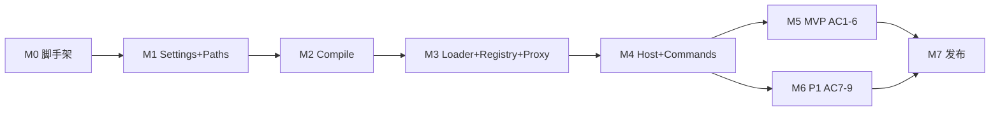

# Vault Scripts 插件 — 项目执行计划（里程碑）

> 交付负责人 / 技术项目经理 · 输入：[prd.md](./prd.md) · [L0.md](./L0.md) · [L1.md](./L1.md)

---

## 1. TL;DR（交付结论）

**MVP 目标**：个人 vault 内实现 **TS/ESM 编写 → PC esbuild 预编译 → PC/Mobile 双端 `vs.<导出名>` 调用** 闭环，通过 **AC-1～AC-6**，不要求遗留脚本迁移。

**平台模型**：单一 `main.js`；**PC 与 Mobile 均启用插件、均可调用 `vs`**；**Compile 仅在 PC（`Platform.isDesktopApp`）运行时初始化**，Mobile 不编译，读 Sync 后的 `dist/`。

**关键路径（7 步）**：

`M0 脚手架` → `M1 配置/路径` → `M2 编译链` → `M3 Runtime 核心` → `M4 编排+命令` → `M5 MVP 验收` → `M7 社区发布`

**P1 延后**：~~孤儿 dist 清理（AC-8）、冲突 Notice（AC-7）、Mobile Sync 验证（AC-9）→ **M6**。~~ → M6 已落地；AC-9 真机签收见 [m6-ac-checklist.md](./m6-ac-checklist.md)。

**当前阻断（P0）**：

1. ~~M5 MVP 验收~~ → 已完成。
2. ~~M6 P1（AC-7～AC-9）~~ → 自动化已完成；AC-9 真机手工可选。
3. **下一环**：M7 社区发布（README、BRAT）。

**建议节奏（单人、兼职假设）**：M0～M5 约 **3～4 周**；M6 + M7 再 **1～2 周**。无硬 deadline 时以 AC 门禁为准，不估绝对日期。

---

## 2. Input Summary（输入摘要）

### 2.1 模块清单（L0）

| L0 模块          | Owned Data                           | 对外契约                             |
| ---------------- | ------------------------------------ | ------------------------------------ |
| Settings         | `VaultScriptsSettings` / `data.json` | PluginSettingTab                     |
| Paths            | 无                                   | `resolvePaths()` → `ResolvedPaths`   |
| Compile          | 写 `dist/`                           | `start` / `rebuild` / `onBuildEnd`   |
| Runtime.Loader   | 内存 cache                           | `loadModule(distPath)`               |
| Runtime.Registry | `ExportEntry[]`                      | `reindexFromDist` / `getEntry`       |
| Runtime.Proxy    | 无                                   | `window.vs`                          |
| Runtime.Commands | command id 列表                      | Obsidian commands                    |
| PluginHost       | 无                                   | Plugin 生命周期 / `plugin.rebuild()` |

### 2.2 契约清单（API + Event）

| 契约                      | 类型     | Producer   | Consumer                              | 强度                     |
| ------------------------- | -------- | ---------- | ------------------------------------- | ------------------------ |
| `resolvePaths`            | API      | Paths      | PluginHost, Compile                   | hard                     |
| `onBuildEnd(BuildResult)` | Event    | Compile    | PluginHost → Registry/Loader/Commands | hard                     |
| `loadModule`              | API      | Loader     | Registry, Proxy                       | hard                     |
| `reindexFromDist`         | API      | Registry   | PluginHost                            | hard                     |
| `createVsProxy`           | API      | Proxy      | PluginHost                            | hard                     |
| `commands.registerAll`    | API      | Commands   | PluginHost                            | soft（MVP 可后于 Proxy） |
| `vs.<ExportName>`         | 用户 API | Proxy      | dataview/Templater                    | hard                     |
| `plugin.rebuild()`        | 插件 API | PluginHost | 命令面板                              | soft                     |

### 2.3 关键场景（端到端）

| #   | 场景                                                             | 追溯 AC          |
| --- | ---------------------------------------------------------------- | ---------------- |
| S1  | **PC** 保存 src → watch → **PC/Mobile** dataview `vs.Xxx.render` | AC-1, AC-2, AC-5 |
| S2  | `static invoke` → **PC/Mobile** 命令面板 / Templater             | AC-3, AC-4       |
| S3  | 导出名冲突 → Notice → `vs.Xxx` 不可用                            | AC-7             |
| S4  | **PC** build 后 Sync → **Mobile** 调用 `vs.Xxx`（同 PC）         | AC-9             |

### 2.4 验收索引（PRD AC）

| ID   | P   | 摘要                   |
| ---- | --- | ---------------------- |
| AC-1 | P0  | 保存 ts → dist 生成    |
| AC-2 | P0  | dataviewjs 调用 render |
| AC-3 | P0  | 命令面板 invoke        |
| AC-4 | P0  | Templater invoke       |
| AC-5 | P0  | watch 热更新           |
| AC-6 | P0  | `_utils` 非 entry      |
| AC-7 | P1  | 导出名冲突             |
| AC-8 | P1  | 删 src → prune dist    |
| AC-9 | P1  | Mobile Sync 一致       |

---

## 3. Input Gaps（缺口清单）

| 级别 | 缺口                              | 影响             | 建议处理                                     |
| ---- | --------------------------------- | ---------------- | -------------------------------------------- |
| P1   | 无人员/时间硬约束                 | ETA 仅为窗口估算 | 以里程碑 Exit Criteria 为准                  |
| P1   | `scriptsRoot` 默认值未拍板        | 首次体验         | 暂用 `scripts`（L1 推荐），Decision Log 记录 |
| P1   | build 失败是否 reindex 未正式拍板 | reindex 行为     | 采纳 L1：**success 才 reindex**              |
| P2   | 无 entry 时 dist 处理策略         | prune 边界       | M6 前拍板；默认保留                          |
| P2   | 示例脚本目录未建（dogfood）       | E2E 无夹具       | ~~M5-WP1~~ `fixtures/` 已建                  |
| P3   | 社区插件审核时间未知              | M7 ETA           | 缓冲 1 周                                    |

---

## 4. Module Dependency Map（模块依赖图谱）

### 4.1 静态依赖（Structural）

| 依赖方     | 依赖项   | 契约/数据               | 强度            |
| ---------- | -------- | ----------------------- | --------------- |
| PluginHost | Settings | `VaultScriptsSettings`  | hard            |
| PluginHost | Paths    | `ResolvedPaths`         | hard            |
| PluginHost | Compile  | `onBuildEnd`, `rebuild` | hard（Desktop） |
| PluginHost | Registry | `reindexFromDist`       | hard            |
| PluginHost | Loader   | `invalidate`            | hard            |
| PluginHost | Commands | `registerAll`           | soft            |
| PluginHost | Proxy    | `createVsProxy`         | hard            |
| Compile    | Paths    | `srcDir`, `distDir`     | hard            |
| Registry   | Loader   | `loadModule`            | hard            |
| Registry   | Paths    | `distDir`               | hard            |
| Proxy      | Registry | `getEntry`              | hard            |
| Proxy      | Loader   | `loadModule`            | hard            |
| Commands   | Registry | `getActiveEntries`      | hard            |
| Commands   | Proxy    | invoke 调用链           | hard            |
| Settings   | Paths    | 路径预览（可选）        | soft            |

### 4.2 交付依赖（MVP slice 最小能力）



| 里程碑 | 必须先具备的最小能力                                 |
| ------ | ---------------------------------------------------- |
| M2     | `resolvePaths.ok` + EntryDiscovery + esbuild 写 dist |
| M3     | dist eval + `vs.Xxx` 可读（可无 Commands）           |
| M4     | onload 全链 + `onBuildEnd` → reindex                 |
| M5     | 示例 entry + watch + dataview/Templater 手工过       |
| M6     | DistPruner + ConflictResolver + MobileBootstrap      |

### 4.3 箭头列表（硬依赖）

```
Paths ──► Compile ──► dist/
dist/ ──► Registry ──► Proxy ──► 用户宿主
Loader ◄── Registry, Proxy
Settings ──► Paths ──► PluginHost
Compile.onBuildEnd ──► PluginHost ──► Registry + Loader + Commands
```

---

## 5. Critical Path（关键路径）

| 节点                  | P   | D   | 阻断风险                 | 先决决策             | 解阻策略                                                |
| --------------------- | --- | --- | ------------------------ | -------------------- | ------------------------------------------------------- |
| **M0 脚手架**         | P0  | D1  | Obsidian 插件构建不熟悉  | —                    | 参照 obsidian-sample-plugin；M0 做最小 main.js 加载验证 |
| **M1 Settings+Paths** | P0  | D0  | scriptsRoot 默认值       | 默认 `scripts` vs 空 | 用 L1 DEFAULT_SETTINGS 推进；PM 后补 Decision           |
| **M2 Compile**        | P0  | D2  | esbuild 在 Obsidian 环境 | external 列表        | 早期集成测：bundle 含 obsidian external                 |
| **M3 Runtime**        | P0  | D2  | eval CJS 在 Mobile       | require shim 白名单  | 单测 + PC 先通 Runtime；Mobile 运行验证延至 M6（AC-9）  |
| **M4 Host 编排**      | P0  | D1  | onBuildEnd 乱序          | buildId 去重         | 按 L1 BuildEventHandler 实现                            |
| **M5 MVP 验收**       | P0  | D1  | 无 dogfood 脚本          | —                    | 新建 2 个 fixture entry，不迁移存量                     |
| **M6 P1**             | P1  | D1  | Mobile 无设备测 AC-9     | —                    | 手工 + 文档；dist 监听可选                              |
| **M7 发布**           | P1  | D1  | 社区审核                 | —                    | 先 BRAT 自用                                            |

**关键路径结论**：Runtime（M3）与 Compile（M2）是技术不确定性最高的两环；**不可并行跳过**。Proxy 依赖 Registry 依赖 Loader 依赖 dist 存在。

---

## 6. Milestone Plan（里程碑计划）

### MVP Slice（Must 上线）

| ID     | 交付物（产品可读）     | In                                            | Out              | 模块                 | 依赖 | 验收                                           | P   | D   | Status | ETA   | 上线策略              |
| ------ | ---------------------- | --------------------------------------------- | ---------------- | -------------------- | ---- | ---------------------------------------------- | --- | --- | ------ | ----- | --------------------- |
| **M0** | 可加载的空插件         | manifest、单入口 `main.js` 构建               | 业务逻辑         | PluginHost 壳        | —    | **PC/Mobile** 均能启用插件                     | P0  | D1  | done   | W1    | 本地 vault 加载       |
| **M1** | 配置与路径解析可用     | Settings 页、data.json、Paths 校验            | 候选路径检测     | Settings, Paths      | M0   | 设置 scriptsRoot 后 `srcDir`/`distDir` 正确    | P0  | D0  | done   | W1    | settings 默认值可回滚 |
| **M2** | **PC** 编译 watch 闭环 | EntryDiscovery、EsbuildRunner、onBuildEnd     | DistPruner       | Compile, Paths       | M1   | **AC-1, AC-5, AC-6**（PC 编译）                | P0  | D2  | done   | W2    | 编译失败保留旧 dist   |
| **M3** | `vs.Xxx` 运行时可用    | Loader、Registry、Proxy                       | 冲突检测 UI      | Runtime.\*           | M2   | **AC-2**（integration）；**PC/Mobile** 读 dist | P0  | D2  | done   | W2–W3 | Runtime 双端          |
| **M4** | 生命周期编排 + 命令    | PluginHost、Commands、Rebuild、dataview touch | Mobile bootstrap | PluginHost, Commands | M3   | **AC-3, AC-4**                                 | P0  | D1  | done   | W3    | onunload 清 vs        |
| **M5** | **MVP 门禁通过**       | fixture 示例、CI 单测/集成、手工 E2E          | 社区发布         | 全模块               | M4   | **AC-1～AC-6 全过**                            | P0  | D1  | done   | W3–W4 | dogfood 本 vault      |

### Post-MVP（Should / Could）

| ID     | 交付物           | In                                           | Out        | 模块                    | 依赖     | 验收                      | P   | D   | Status | ETA   | 上线策略       |
| ------ | ---------------- | -------------------------------------------- | ---------- | ----------------------- | -------- | ------------------------- | --- | --- | ------ | ----- | -------------- |
| **M6** | P1 体验与 Mobile | DistPruner、Conflict Notice、MobileBootstrap | dist 监听  | Compile, Registry, Host | M5       | **AC-7, AC-8, AC-9**      | P1  | D1  | done   | W4–W5 | 冲突名不挂 vs  |
| **M7** | 社区插件发布     | README、BRAT、版本号                         | npm bundle | 文档                    | M5 或 M6 | 他人可安装；回滚=禁用插件 | P1  | D1  | todo   | W5–W6 | 先 BRAT 后官方 |
| **M8** | P2 增强          | vs.d.ts、npm 依赖                            | —          | Compile/工具            | M7       | 独立 AC（待写）           | P2  | D2  | todo   | 未定  | 可选 flag      |

---

## 7. Work Packages（工作包）

### M0 — 插件脚手架

| WP     | 目标           | 交付物                                            | Exit Criteria                 | Evidence    | 依赖   | 风险                   | D   | Status | ETA     | Owner |
| ------ | -------------- | ------------------------------------------------- | ----------------------------- | ----------- | ------ | ---------------------- | --- | ------ | ------- | ----- |
| M0-WP1 | 仓库结构       | `vault-scripts/` 目录、manifest、tsconfig、eslint | `pnpm run build` 产出 main.js | integration | —      | P2 目录与 vault 根关系 | D0  | done   | W1 D1-2 | 后端  |
| M0-WP3 | 空 Plugin 加载 | main.ts onload/onunload、Settings 壳              | Obsidian 启用无报错           | manual-demo | M0-WP1 | —                      | D0  | done   | W1 D5   | 后端  |

### M1 — Settings + Paths

| WP     | 目标                     | 交付物             | Exit Criteria           | Evidence    | 依赖     | 风险          | D   | Status | ETA | Owner |
| ------ | ------------------------ | ------------------ | ----------------------- | ----------- | -------- | ------------- | --- | ------ | --- | ----- |
| M1-WP1 | SettingsStore            | load/save/defaults | 单测默认值 merge        | unit        | M0       | P1 默认值争议 | D0  | done   | W1  | 后端  |
| M1-WP2 | PathValidator + Resolver | `resolvePaths`     | 单测 `..`/空/正常路径   | unit        | M1-WP1   | —             | D0  | done   | W1  | 后端  |
| M1-WP3 | SettingsTab              | 4 字段 + 路径预览  | 保存后 data.json 持久化 | manual-demo | M1-WP1,2 | —             | D0  | done   | W1  | 前端  |

### M2 — Compile

| WP     | 目标              | 交付物                    | Exit Criteria                 | Evidence    | 依赖   | 风险                 | D   | Status | ETA | Owner |
| ------ | ----------------- | ------------------------- | ----------------------------- | ----------- | ------ | -------------------- | --- | ------ | --- | ----- |
| M2-WP1 | EntryDiscovery    | discover 规则             | **AC-6** unit                 | unit        | M1     | —                    | D0  | done   | W2  | 后端  |
| M2-WP2 | EsbuildRunner     | build + watch + sourcemap | temp vault **AC-1**           | integration | M2-WP1 | **P1** external 漏配 | D1  | done   | W2  | 后端  |
| M2-WP3 | BuildOrchestrator | onBuildEnd 事件、buildId  | contract BuildResult schema   | contract    | M2-WP2 | P1 失败仍 emit       | D1  | done   | W2  | 后端  |
| M2-WP4 | watch 热更新      | autoWatch 设置联动        | **AC-5** 保存后 dist mtime 变 | integration | M2-WP3 | —                    | D1  | done   | W2  | 后端  |

### M3 — Runtime 核心

| WP     | 目标            | 交付物                       | Exit Criteria               | Evidence    | 依赖   | 风险             | D   | Status | ETA | Owner |
| ------ | --------------- | ---------------------------- | --------------------------- | ----------- | ------ | ---------------- | --- | ------ | --- | ----- |
| M3-WP1 | ModuleLoader    | cache + require shim + retry | 单测 cache hit/miss         | unit        | M2     | **P1** eval 安全 | D1  | done   | W2  | 后端  |
| M3-WP2 | ExportRegistry  | reindex eval 索引            | integration 单 entry        | integration | M3-WP1 | P1 eval vs AST   | D1  | done   | W3  | 后端  |
| M3-WP3 | LazyExportProxy | class static + function 分支 | 单测 + mock loader          | unit        | M3-WP2 | P2 Proxy inspect | D1  | done   | W3  | 后端  |
| M3-WP4 | Runtime 集成    | Registry + Proxy 联调        | 加载 fixture dist 调 static | integration | M3-WP3 | —                | D1  | done   | W3  | 后端  |

### M4 — Host + Commands

| WP     | 目标              | 交付物                                | Exit Criteria       | Evidence    | 依赖   | 风险                    | D   | Status | ETA | Owner |
| ------ | ----------------- | ------------------------------------- | ------------------- | ----------- | ------ | ----------------------- | --- | ------ | --- | ----- |
| M4-WP1 | LifecycleManager  | onload 顺序（L1）；**PC/Mobile 分支** | 日志验证调用序      | integration | M2,M3  | P1 Compile 仅 PC 初始化 | D1  | done   | W3  | 后端  |
| M4-WP2 | BuildEventHandler | success 才 reindex；buildId 去重      | contract 幂等       | contract    | M4-WP1 | —                       | D1  | done   | W3  | 后端  |
| M4-WP3 | CommandRegistry   | invoke + Rebuild 命令                 | **AC-3**            | e2e         | M4-WP1 | —                       | D0  | done   | W3  | 后端  |
| M4-WP4 | DataviewTouch     | touchDataview 可选                    | dataview 安装时刷新 | manual-demo | M4-WP2 | P2 未安装 dataview      | D0  | done   | W3  | 后端  |

### M5 — MVP 验收门禁

| WP     | 目标         | 交付物                                | Exit Criteria        | Evidence          | 依赖   | 风险                    | D   | Status | ETA | Owner  |
| ------ | ------------ | ------------------------------------- | -------------------- | ----------------- | ------ | ----------------------- | --- | ------ | --- | ------ |
| M5-WP1 | Fixture 示例 | ProjectReport + CreateProject 示例 ts | src 可编译           | integration       | M4     | —                       | D0  | done   | W3  | 后端   |
| M5-WP2 | CI 管道      | unit + integration 在 push 跑         | CI green             | unit, integration | M5-WP1 | P2 无 Obsidian headless | D1  | done   | W4  | DevOps |
| M5-WP3 | 手工 E2E     | dataview + Templater 场景             | **AC-2, AC-4, AC-5** | e2e, manual-demo  | M5-WP1 | P1 依赖已装插件         | D0  | done   | W4  | QA     |
| M5-WP4 | MVP 签收     | AC 核对表                             | AC-1～6 全 ✓         | manual-demo       | M5-WP3 | —                       | D0  | done   | W4  | PM     |

### M6 — P1

| WP     | 目标             | 交付物                                          | Exit Criteria | Evidence    | 依赖 | 风险             | D   | Status | ETA | Owner |
| ------ | ---------------- | ----------------------------------------------- | ------------- | ----------- | ---- | ---------------- | --- | ------ | --- | ----- |
| M6-WP1 | DistPruner       | pruneOrphanDist                                 | **AC-8**      | integration | M5   | P2 无 entry 策略 | D1  | done   | W4  | 后端  |
| M6-WP2 | ConflictResolver | Notice + 不注册                                 | **AC-7**      | unit, e2e   | M5   | —                | D0  | done   | W4  | 后端  |
| M6-WP3 | MobileBootstrap  | **Mobile** 跳过 compile、dist Notice、dist 监听 | **AC-9**      | manual-demo | M5   | **P1** 需真机    | D1  | done   | W5  | QA    |

### M7 — 发布

| WP     | 目标        | 交付物                            | Exit Criteria           | Evidence    | 依赖   | 风险        | D   | Status | ETA  | Owner  |
| ------ | ----------- | --------------------------------- | ----------------------- | ----------- | ------ | ----------- | --- | ------ | ---- | ------ |
| M7-WP1 | 文档        | README：安装、scriptsRoot、vs API | 新用户可按文档跑通 AC-1 | manual-demo | M5     | —           | D0  | todo   | W5   | PM     |
| M7-WP2 | BRAT 发布   | 版本 tag + release                | 第二 vault 可安装       | manual-demo | M7-WP1 | —           | D0  | todo   | W5   | DevOps |
| M7-WP3 | 社区仓库 PR | obsidian-releases 提交            | 审核中或 merged         | manual-demo | M7-WP2 | P2 审核时长 | D1  | todo   | W5–6 | PM     |

---

## 8. Risks / Assumptions / Issues / Decisions（RAID）

| 类型           | P   | 条目                                                   | 缓解 / 验证 / 方案                                       | Owner           |
| -------------- | --- | ------------------------------------------------------ | -------------------------------------------------------- | --------------- |
| **Risk**       | P2  | Mobile 加载含 esbuild 的 main.js → 体积偏大            | Mobile 仅运行时不调用 Compile（`Platform.isDesktopApp`） | 后端            |
| **Risk**       | P1  | eval 索引 dist 在大量 entry 时慢                       | reindex 仅 onBuildEnd；P2 并行限流                       | 后端            |
| **Risk**       | P1  | Obsidian 升级破坏 fs/eval API                          | 锁定测试 Obsidian 最低版本；发布说明                     | PM              |
| **Risk**       | P1  | Sync 延迟 Mobile 旧 dist                               | 文档 + M6 可选监听                                       | PM              |
| **Risk**       | P2  | 无 headless Obsidian → CI 有限                         | 核心 logic unit/integration 不依赖 UI                    | QA              |
| **Assumption** | P0  | **PC/Mobile 同一 `main.js`**；Compile 仅 PC 运行时启用 | L4/M4 分支；M6-WP3 验证 Mobile                           | 架构            |
| **Assumption** | P0  | 用户 PC 先 build 后 Mobile 才可用 Sync dist            | M6-WP3 验证；README 写明                                 | PM              |
| **Assumption** | P0  | dist 在 `.obsidian/plugins/vault-scripts/dist/`        | Paths 写死；Sync 同步                                    | 后端            |
| **Assumption** | P1  | 单人维护，无并行研发                                   | 里程碑串行；M6 可略延后                                  | PM              |
| **Issue**      | P1  | AC-9 需 Mobile 设备                                    | 手工排期；可借设备或延后 M6                              | QA              |
| **Decision**   | P0  | 单入口 main.js；Mobile 不调用 Compile                  | 运行时 `Platform.isDesktopApp` 分支                      | 架构 **已决**   |
| **Decision**   | P1  | `scriptsRoot` 默认 `scripts`                           | 暂采纳 L1；PM 确认                                       | PM              |
| **Decision**   | P1  | build 失败不 reindex                                   | 保留旧 index（L1）                                       | 架构 **已建议** |
| **Decision**   | P2  | MVP 不支持 export default                              | 文档说明 named export                                    | PM              |
| **Decision**   | P3  | 插件显示名 Vault Scripts                               | PRD 推荐 A                                               | PM **倾向已决** |

---

## 9. Execution Logs（执行记录模板）

### 9.1 Weekly Status（周报）

```markdown
## Weekly Status — Vault Scripts — YYYY-MM-DD

### 本周完成

- [M?-WP?] …
- 里程碑状态变更：M? → doing/done

### 下周计划

- [M?-WP?] …

### 阻塞（P0/P1）

- P0：…
- P1：…

### RAID 更新

- 新增 Risk/Decision：…
- 已关闭：…
```

### 9.2 Decision Log（决策记录）

```markdown
| 日期       | 决策点             | 选项         | 结论    | 影响面            | 相关里程碑 |
| ---------- | ------------------ | ------------ | ------- | ----------------- | ---------- |
| YYYY-MM-DD | scriptsRoot 默认值 | 空 / scripts | scripts | Settings 首次体验 | M1         |
```

### 9.3 Change Log（范围/设计变更）

```markdown
| 日期       | 变更 | 原因 | 影响里程碑 | 影响关键路径 | 新验收口径 |
| ---------- | ---- | ---- | ---------- | ------------ | ---------- |
| YYYY-MM-DD | …    | …    | M?         | 是/否        | AC-?       |
```

### 9.4 Progress Update（进度更新协议）

```markdown
| ID     | Status | %   | ETA | Blockers | Evidence       | lastUpdated |
| ------ | ------ | --- | --- | -------- | -------------- | ----------- |
| M2-WP2 | doing  | 60  | W2  | —        | PR # / CI link | YYYY-MM-DD  |
```

**规则**：

- WP 标记 `done` 前须有 Exit Criteria 对应 evidence（测试输出、PR、手工记录）。
- Milestone 标记 `done` 当且仅当该里程碑下所有 P0 WP 完成且验收口径通过。
- M5 完成 = MVP 可对外（至少 BRAT）。

---

## 10. Next Actions（下一步行动）

| P   | 行动                                                           | 产出         | 负责 |
| --- | -------------------------------------------------------------- | ------------ | ---- |
| P0  | 启动 M7：README 安装说明 + BRAT 发布准备                       | M7 开工      | PM   |
| P1  | 真机完成 AC-9 签收：[m6-ac-checklist.md](./m6-ac-checklist.md) | M6 闭环      | 用户 |
| P1  | README 大纲：安装、scriptsRoot、vs 约定                        | M7 前置      | PM   |
| P2  | 确认本 vault `scriptsRoot` 实际值（如 `900-vault/scripts`）    | dogfood 配置 | 用户 |
| P3  | 社区插件账号 / BRAT 仓库准备                                   | M7 前置      | PM   |

---

## 附录：里程碑 ↔ 场景 ↔ AC 追溯

| 里程碑 | 场景      | AC               |
| ------ | --------- | ---------------- |
| M2     | S1 编译段 | AC-1, AC-5, AC-6 |
| M3     | S1 运行段 | AC-2             |
| M4     | S2 命令   | AC-3, AC-4       |
| M6     | S3 冲突   | AC-7             |
| M6     | S1 清理   | AC-8             |
| M6     | S4 Mobile | AC-9             |

---

_Delivery Plan v1.0 · 对齐 PRD v1.2 · L0 v1.0 · L1 v1.0_
